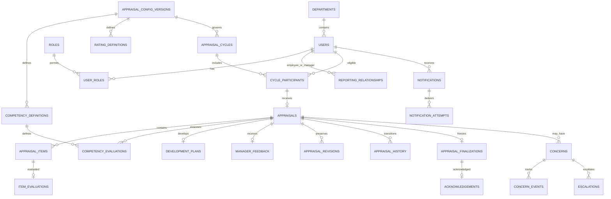

# Proposed database schema

Design proposal for MySQL 8.4 LTS, InnoDB, utf8mb4. No schema or migration has been applied. SQLAlchemy 2.x models and Alembic migrations are Phase 2 work. Use UTC timestamps with microseconds and cycle-specific IANA timezone for deadlines; display user-local dates. Resolve scoring precision and applicability before finalizing the corresponding column definitions.

## Entities and keys

All entities use a primary key `id` unless stated otherwise. Foreign keys use RESTRICT deletion for business/history records. Physical deletion of users, cycles, appraisals, and published configuration is unavailable through normal APIs. User identifiers exposed by API should be opaque IDs; opaque IDs do not replace authorization.

| Table | Principal columns and constraints |
|---|---|
| departments | unique `code`, name, active |
| users | unique employee_id, unique canonical_email, full_name, department_id FK, designation, country, employing_entity, active, created_at, last_login_at, version |
| credentials | user_id PK/FK, password_hash, must_change_password, credentials_changed_at; no plaintext or reversible password |
| roles | unique code constrained to SUPER_ADMIN / HR / MANAGER / EMPLOYEE |
| user_roles | composite PK(user_id, role_id), assigned_by FK users, assigned_at; whether multiple privileged roles are enabled is pending |
| reporting_relationships | employee_id FK users, manager_id FK users, valid_from, valid_to, created_by, reason; employee != manager, intervals must not overlap |
| sessions | user_id FK, unique token_hash, csrf_token_hash, created_at, expires_at, revoked_at, last_seen_at; raw token never persisted |
| password_setup_tokens | user_id FK, unique token_hash, purpose SETUP/RESET, issued_by, expires_at, consumed_at; one use, bounded lifetime |
| auth_rate_limits | hashed principal/IP bucket, endpoint, window_start, attempt_count, blocked_until; unique bucket/window; persistent shared limiter |
| appraisal_config_versions | version label unique, status DRAFT/PUBLISHED, source workbook SHA256, instructions, section limits/weights, scoring_policy_version, required-field/applicability rules, rounding policy, created_by, published_at |
| rating_definitions | config_version_id FK, integer rating 1–5, label, goal_guidance, competency_guidance; unique(config_version_id, rating) |
| competency_definitions | config_version_id FK, stable key, label, display_order, applicability rule; unique(config_version_id, stable key) and order |
| appraisal_cycles | unique code, title, period_start/end, timezone, employee_deadline, resubmission policy, manager_deadline, release_deadline, status DRAFT/ACTIVE/CLOSED, config_version_id FK, version |
| cycle_participants | cycle_id FK, employee_id FK, reporting_relationship_id FK, eligible_from, eligibility_basis, included_by; unique(cycle_id, employee_id) |
| appraisals | cycle_participant_id unique FK, employee_id, cycle_id, manager_id FK, config_version_id FK, identity_snapshot JSON, state, content_revision, row_version, started_at, submitted_at, review_started_at, finalized_at, released_at; unique(employee_id, cycle_id) |
| appraisal_items | appraisal_id FK, kind GOAL/CONTRIBUTION, position, description, employee_narrative; unique(appraisal_id, kind, position), allowed positions validated against config |
| item_evaluations | item_id unique FK, manager_id FK, nullable integer rating, comment, evaluated_content_revision, version; CHECK rating IS NULL OR rating BETWEEN 1 AND 5 |
| competency_evaluations | appraisal_id FK, competency_definition_id FK, manager_id FK, applicability APPLICABLE/NOT_APPLICABLE/UNDECIDED, applicability_reason, nullable integer rating, comment, version; unique(appraisal_id, competency_definition_id) |
| development_plans | appraisal_id unique FK, business_achievements, development_achievements, six_month_growth, development_needs, development_plan, support_requested |
| manager_feedback | appraisal_id unique FK, manager_id FK, strengths, improvement_areas; optional future objectives/overall comments only after decision |
| appraisal_revisions | appraisal_id FK, revision_no, author_id, created_at, response_snapshot JSON; unique(appraisal_id, revision_no); preserve submitted/resubmitted content |
| appraisal_history | appraisal_id FK, actor_id FK, from_state, to_state, command, reason, content_revision, occurred_at; append-only |
| appraisal_finalizations | appraisal_id unique FK, manager_id FK, config_version_id FK, scoring_policy_version, goals_count/sum, contributions_count/sum, competencies_count/sum, score_snapshot JSON, final_content_snapshot JSON, finalized_at |
| acknowledgements | appraisal_id unique FK, employee_id FK, acknowledged_at, optional comment, finalization_id FK; append-only, does not change score |
| concerns | employee_id/manager_id/appraisal_id optional FKs, stage optional, description, priority, responsible_user_id FK, due_at, status, resolution_notes, created_by, created_at, version; require at least one valid target |
| concern_events | concern_id FK, actor_id, event_type, previous/new status, notes, occurred_at; append-only |
| escalations | concern_id or appraisal_id FK target, raised_by, assigned_to, level, reason, outcome, created_at, resolved_at; at least one valid target |
| notification_policies | cycle_id FK, trigger, interval_seconds, threshold_seconds, enabled, policy_version, created_by |
| notification_outbox | unique event_key, event_type, aggregate_id, recipient_id FK, available_at, status, attempts, locked_until; written in triggering transaction |
| notifications | recipient_id FK, event_key, type, resource_id, safe_message, created_at, read_at, transport IN_APP initially; unique(recipient_id, event_key, transport) |
| notification_attempts | notification_id/outbox_id FK, attempted_at, status, next_retry_at, safe_error_code; no credentials/content dumps |
| audit_events | actor_id nullable FK for bootstrap/system, action, resource_type/id, outcome, safe change metadata, request_id, occurred_at; append-only |

Small policy documents and immutable snapshots use JSON because they are read as a versioned unit. Mutable queryable responses and ratings remain relational. Typed DTOs validate JSON structures. Finalization stores sums/counts plus authoritative unrounded result representation and display values. Exact decimal scale is pending approval; do not select a scale that silently changes tie behavior. Reports consume final snapshots rather than independently rescoring.

## Relationships

Optional concern targets mean an employee/manager concern need not reference an appraisal. The diagram is a main relationship map; the table above specifies other FKs.

## Integrity, indexing, transactions

- Index appraisals(cycle_id, state), appraisals(manager_id, cycle_id, state), users(department_id, active), history(appraisal_id, occurred_at), concerns(status, due_at, responsible_user_id), notifications(recipient_id, read_at, created_at), outbox(status, available_at), audit_events(resource_type, resource_id, occurred_at). Allowlisted sorting uses indexed fields; profile snapshots preserve past report grouping.
- Canonicalize email before unique checking; decide employee ID case sensitivity. Concurrency relies on database UNIQUE constraints, not preflight checks alone.
- Same-appraisal child writes must be checked against the owning appraisal inside a transaction. Evaluate only competency definitions belonging to its bound config. Use composite FK constraints where practical and service validation otherwise. Do not accept client-supplied author or manager IDs.
- Prevent overlapping reporting intervals and hierarchy cycles under a serialized relationship-update transaction. MySQL cannot express interval exclusion with a simple CHECK. Changing the directory manager closes/opens relationships and audits the event; it never rewrites appraisal.manager_id.
- Role grant/deactivation transactions lock a common admin-guard record before counting active Super Admins, so two simultaneous changes cannot remove the last one. Define the small guard table in the migration when implementing this invariant.
- Finalization locks the appraisal; verifies current revision, actor, state, completeness; computes once; inserts immutable finalization; appends history/audit/outbox and commits atomically. Add application-level denial of content edits in FINALIZED/RELEASED to all write paths, including bulk APIs and scripts. Database permissions deny ordinary UPDATE/DELETE on finalizations/history/audits; separate migration credentials.
- Historical employee identity, department, employing entity, manager assignment, config, and review results remain bound to the appraisal. Current profile changes never re-group historical reports silently. Cross-cycle comparisons require compatible scoring versions and populations.
- Cycle deadline changes are audited and versioned as policy events. Published scoring configurations cannot be edited in place; new records use a new published version under an approved activation policy. Do not change existing finalizations.
- Reminder workers claim outbox rows transactionally. A unique event key includes trigger, appraisal/concern, recipient, policy version, and interval bucket. Retry delivery uses the same key. Manual triggers obey deduplication too.
- Report export records an audit event with actor, authorized scope, cycle, filters, format, and generation time. CSV formula-injection protection applies to user-originated text. Export generation never writes appraisals.
- Alembic acceptance uses fresh install, upgrade from prior revision, constraint checks, and backup/restore rehearsal against real MySQL. SQLite-only tests cannot validate MySQL behavior.
