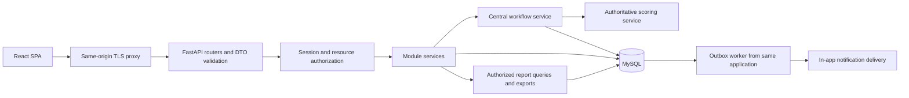

# Proposed technical architecture

## Module boundaries

React/TypeScript SPA calls a same-origin FastAPI modular monolith. SQLAlchemy 2.x uses one transactional MySQL database; Alembic owns schema evolution. A worker entry point in the same codebase processes durable notification outbox rows. No microservices or separate broker are needed initially. Reverse proxy serves the SPA and `/api`; TLS is required outside local development.



Routers handle transport; services own authorization-aware commands and transactions; repositories encapsulate meaningful query logic without generic CRUD inheritance. `appraisals` owns employee responses and immutable snapshots, `reviews` owns manager evaluation commands, and both delegate state changes to the central appraisal workflow. `hr` manages cycles/concerns and cannot call content-writing repositories. `reports` is read-only for appraisals and uses persisted final scores. `audit` is append-only. Notifications act on domain events and never modify appraisal state. Dependencies flow from API to services to DB; avoid cross-router calls and circular module imports.

## Proposed folder structure

Only `docs/`, discovery tools, and README exist now. This structure is the Phase 2 onward target, not a claim of scaffolded implementation.

```text
frontend/
  package.json
  package-lock.json
  vite.config.ts
  tsconfig.json
  src/
    app/                    # shell, routes, providers, role-aware navigation
    api/                    # typed fetch client, errors, CSRF, generated types
    components/             # fields, tables, pagination, dialogs, status badges
    features/
      auth/                 # login, password setup/change
      users/                # admin directory and account forms
      appraisals/           # personal dashboard, reusable source-based sections
      reviews/              # assigned team and manager review
      hr/                   # monitoring, cycles, concerns, escalation
      reports/              # report filters, metrics, export
      notifications/        # personal inbox
    theme/                  # corporate asset references, configurable CSS tokens
    types/
    utils/                  # display/validation helpers, never score calculation
    tests/                  # shared component/accessibility support
  e2e/                      # four-role Playwright workflows
backend/
  pyproject.toml
  requirements.lock
  alembic.ini
  app/
    main.py
    worker.py
    core/                   # settings, hashing/session helpers, exceptions
    api/                    # router registration, actor/session/CSRF dependencies
    db/                     # SQLAlchemy base, session factory, transaction helpers
    modules/
      auth/
      users/
      appraisals/           # workflow.py, response services, configuration versions
      reviews/              # scoring.py, evaluation service
      hr/                   # deadlines, cycles, concerns
      reports/
      notifications/
      audit/
  migrations/versions/
  tests/
    unit/
    integration/
    authorization/
deployment/
  compose.yaml
  backend.Dockerfile
  frontend.Dockerfile
  proxy.conf
docs/
tools/
.env.example                # keys/placeholders only
```

Within substantial modules use `models.py`, `schemas.py`, `router.py`, `service.py`, `repository.py` only where needed. Separate employee and review DTOs and services prevent mass assignment of sensitive fields. Shared React sections compose repeated goals/contributions/competencies rather than copying markup.

## Authentication and security design

Proposed authentication uses random opaque sessions, stored hashed in the DB and sent in HttpOnly, Secure, SameSite=Lax cookies. Do not store bearer/session secrets in browser localStorage. Rotate session on login/password change, set bounded idle/absolute expiry, revoke all applicable sessions on reset/deactivation, and restrict first-login sessions to password change/logout. Exact expiry and password policy need confirmation. Require a server-validated session-bound CSRF token plus Origin checks on state-changing browser requests. Local HTTP cookie settings must be isolated from production defaults.

Use Argon2id via argon2-cffi, benchmark parameters for deployment, never log hashes, tokens or passwords. Public reset requests respond identically for existing/missing accounts. Reset/setup tokens are random, stored hashed, one-use, expiring, and delivered only through the approved channel. Until an email transport exists, an authenticated administrative handoff process must be defined; no plaintext-password email or reusable public reset token response. Admin-set temporary passwords are an explicitly supported alternative with mandatory first-login change, no password retrieval, and session revocation.

Use a shared persistent rate limiter for login/reset/setup by principal and IP; no per-process memory-only protection in production. Restrict trusted proxy headers. Validate roles and ownership for every endpoint and export; a hidden React navigation item provides no security. Defense includes parameterized ORM queries, strict typed inputs, length limits, CORS allowlist only when cross-origin deployment is explicitly configured, restrictive CSP, frame protection, and safe content rendering. Do not render employee narratives as HTML.

Configure DB/session secrets via environment/secret storage, fail startup on missing production secrets, and use separate migration credentials. Audit sensitive success/failure events with safe metadata and request IDs. Do not log appraisal narratives unnecessarily. Backups require encryption, restricted access and tested restores. Retention, regional hosting, export access and audit-access policies remain business decisions.

## Branding evidence and theme proposal

Source: [official homepage](https://medimpactinternational.com/), inspected 20 October 2026. `evidence/corporate-home.html` contains `style#elementor-frontend-inline-css`, `.elementor-kit-1431`. The linked optimized CSS was also inspected but includes unrelated plugin/social colors; do not treat its full color list as the corporate palette. `evidence/branding-inventory.json` preserves the actual global declarations and logo references.

| Website token | Verified value | Proposed application use |
|---|---|---|
| --e-global-color-primary | #702C91 | Primary actions, navigation emphasis |
| --e-global-color-secondary | #FE2072 | Restrained accent; contrast-check per use |
| --e-global-color-accent | #965DD4 | Secondary brand accent |
| --e-global-color-85b4203 | #250644 | Dark brand surface/header |
| --e-global-color-75839ad | #5BCBDA | Optional secondary accent |
| --e-global-color-text | #000000 | Text |
| --e-global-color-f57a390 | #FFFFFF | Surface/inverse text |
| --e-global-color-8e3ae2e | #5A5A5A | Secondary text where contrast allows |
| --e-global-color-1dcfe91 | #363436 | Dark neutral text |
| --e-global-color-2c443ca | #FEFCFA | Warm light surface |

Primary, secondary, text, and accent typography all name **Franklin Gothic ATC**. Inline font-face rules point to `medImpactTech-Franklin_Gothic_ATF*.otf` under `/wp-content/uploads/2026/05/`; the CSS family spelling differs from the file names and some source format declarations are inconsistent with `.otf`. Do not copy these rules blindly. Establish permitted font distribution and valid browser formats; until available, use an explicitly provisional system sans-serif fallback, not an invented official font.

Official logo references in header/footer:

- [Clear-background WebP](https://medimpactinternational.com/wp-content/uploads/2026/03/MedImpact-International-Clear-Background.webp), declared native size 948×332.
- [Alternate PNG](https://medimpactinternational.com/wp-content/uploads/2026/05/MI-International-Logo-1.png), declared displayed size 128×51.

Browser inspection confirmed the white MedImpact International wordmark on a dark purple header, uppercase bold promotional headings, purple imagery overlays, pink emphasis/buttons, and spacious grouped navigation. Direct image retrieval by the web text tool failed; the logo was inspected in the rendered homepage instead. Asset references are identified, not repackaged or represented as licensed for redistribution. Confirm approved asset variant and use rights before bundling; preserve proportions and avoid redrawing the mark. The workbook entity heading is MedImpact India (GBS) Pvt Ltd and requires a regional-entity decision separate from the global product mark.

Proposed theme uses centralized CSS variables mapping these source tokens to semantic roles, with configurable logo URL/font choice. Product title remains MI LeapMetrics. Adopt the source colors and restrained identity while using sentence-case forms, readable 16px body text, clear focus, generous spacing and compact responsive tables for the application. Choose status/error colors for semantic accessibility, document them as application tokens rather than official brand colors, and always include text/icons. Confirm contrast at WCAG AA for every final pairing; pink/white and pale accents must not be assumed compliant.

UI acceptance includes keyboard navigation, persistent labels, field errors associated with inputs, error summary, accessible dialogs, mobile/tablet layouts, loading/empty/error/success states, explicit pending-action owner, draft-save feedback and a submission review screen. Role navigation always includes My appraisal. Manager review UI separates read-only employee answers from editable manager fields. There are no employee numerical score controls.

## Candidate dependency baseline and setup

Registry metadata was retrieved during discovery and saved with runtime requirements in `evidence/version-candidates.json`. These are **candidate pins**, not a tested compatibility lock. Phase 2 must resolve dependencies together, check advisories, build, and record the tested exact locks before adoption. No packages were installed into this repository.

| Component | Proposed target / observed candidate |
|---|---|
| Node.js | 24 LTS runtime target; exact maintained patch selected during setup |
| Python | 3.13 runtime target; exact maintained patch selected during setup |
| MySQL | 8.4 LTS target; exact maintained image digest selected during setup |
| React / matching react-dom | 19.3.1 candidate; matching react-dom version must be verified |
| TypeScript / Vite | 7.0.2 / 8.3.4 candidates |
| Vitest / Playwright | 5.0.5 / 1.64.1 candidates |
| FastAPI / Uvicorn | 0.151.0 / 0.54.0 candidates |
| SQLAlchemy / Alembic / PyMySQL | 2.1.5 / 1.20.0 / 1.2.3 candidates |
| Pydantic / pydantic-settings | 2.14.1 / 2.16.0 candidates |
| argon2-cffi | 25.1.0 candidate |
| Pytest / HTTPX | 9.1.1 / 0.28.1 candidates |
| XLSX / PDF export libraries | openpyxl 3.1.5 / reportlab 5.0.1 candidates for backend runtime exports |

The official [React versions](https://react.dev/versions), [Vite setup requirements](https://vite.dev/guide/), [FastAPI version guidance](https://fastapi.tiangolo.com/deployment/versions/), and [SQLAlchemy overview](https://docs.sqlalchemy.org/en/20/intro.html) were consulted. Pin FastAPI with its compatible resolved Starlette dependency rather than choosing Starlette separately. Runtime constraints observed for Vite include Node 20.19+ or 22.12+; Vitest candidate requires 22.12+/24+/26+, so Node 24 fits their declared ranges. All observed Python candidates accept Python 3.13 at the metadata level; this does not establish binary availability or combined runtime compatibility. Confirm Node/Python/MySQL support status at implementation time.

Setup requirements: Git for source control, selected Node/npm and Python/venv, MySQL or Docker Compose, Playwright browser dependencies, environment secrets and a restricted bootstrap-admin process. Phase 2 should add reproducible install/build/test commands, lockfiles, frontend type generation from OpenAPI, liveness/readiness endpoints, migration startup process and an `.env.example`. Do not make container startup create default production accounts or silently run destructive migrations.
